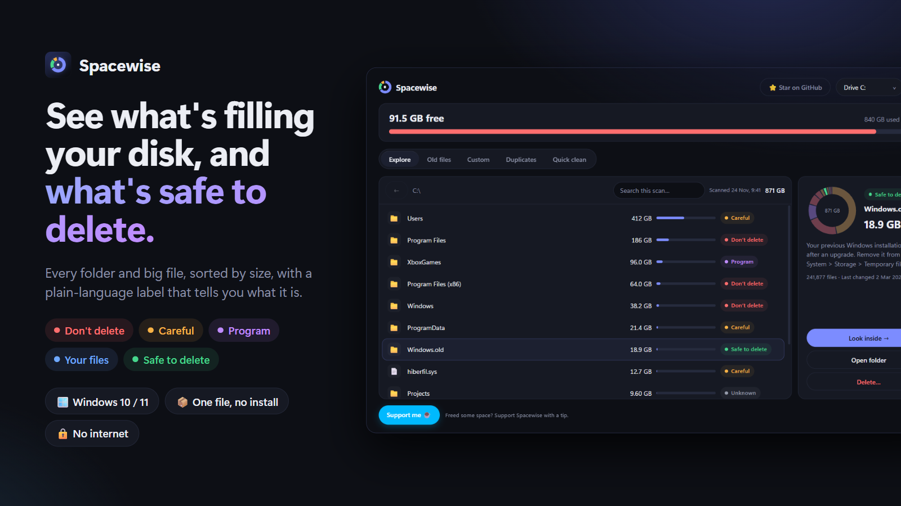
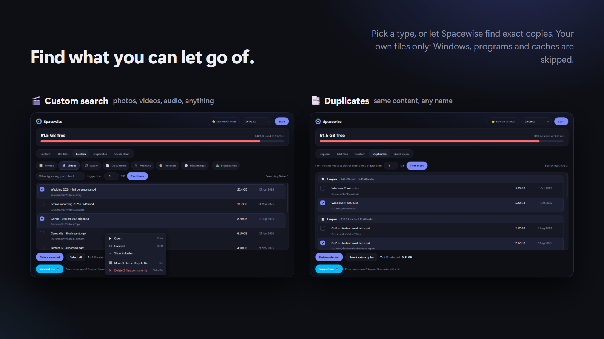
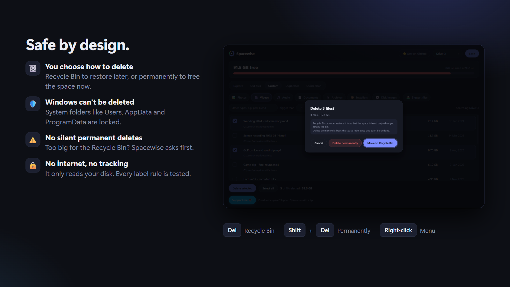

<p align="center"></p>

<p align="center">
  <a href="../../releases/latest"></a>
  <a href="../../actions"></a>
  
  
  <a href="https://ko-fi.com/iizhq55"></a>
</p>

Most disk tools show you *how big* things are. **Spacewise also tells you *what they are*:**

- `AppData` is your programs' settings, so leave it alone.
- `node_modules` can be re-downloaded.
- `hiberfil.sys` can be switched off if you never hibernate.

You only delete what you understand.

## Download

Get **`Spacewise.exe`** from [Releases](../../releases/latest) and run it. It's one file: no installer and no .NET needed. It runs on Windows 10 and 11 (64-bit).

> Windows may show "Windows protected your PC" because the app isn't signed yet. Click **More info → Run anyway**.

## Every item, explained

Scan a drive and Spacewise lists every folder and big file, biggest first, with a ring chart of the folder you're in. Each item gets a label and a one-line explanation:

| Label | What it means |
|---|---|
| 🔴 **Don't delete** | Windows itself. The app won't delete these at all. |
| 🟠 **Careful** | Core system data and settings, like `AppData`, `ProgramData` and the hibernation file. |
| 🟣 **Program** | An installed program or game, or its data. Spacewise points you to uninstall it properly. |
| 🔵 **Your files** | Your own stuff. Delete what you don't need. |
| 🟢 **Safe to delete** | Caches and temp files that get recreated. |

Double-click a folder to go inside, or a file to open it (videos play, pictures open). Search the whole scan by name. Your last scan is remembered, so the app opens with results.

<p align="center"></p>

## Find what you can let go of

- **Custom search.** Pick photos, videos, audio, documents, archives, installers or disk images, or type your own extensions (like `psd, blend`). Or pick **Biggest files** to see the largest files on the drive.
- **Duplicates.** Files with exactly the same content, even under different names. Same size first, then the content itself, so only real copies match. One click selects the extra copies, and Spacewise never lets you delete every copy.
- **Old files.** Big files in Downloads, Desktop, Documents, Pictures, Videos and Music that you haven't changed in months.
- **Quick clean.** One click clears these:
  - temp files
  - browser caches (Chrome, Edge, Brave, Opera)
  - thumbnail cache
  - crash reports
  - Windows Update leftovers
  - the Recycle Bin
- **Turn off hibernation.** If you never hibernate, one click frees the space `hiberfil.sys` takes (often several GB).

Searches skip Windows, programs and caches, so you only see your own files.

<p align="center"></p>

## Safe by design

- **You choose how to delete.** Move to the Recycle Bin (you can restore it later) or delete permanently (frees the space right away).
- **No silent permanent deletes.** If something can't go to the Recycle Bin (too big for it, or on a USB drive without one), Spacewise tells you. It deletes it only if you choose "Delete permanently".
- **System folders are locked.** Windows, and folders like `Users`, `AppData` and `ProgramData`, can't be deleted from the app.
- **It never runs programs.** Double-clicking an `.exe` or a script shows it in its folder instead of running it.
- **Recent temp files are left alone.** Cleanup skips anything changed in the last 24 hours, in case a program is still using it.
- **No internet, no accounts, no tracking.** It only reads your disk.
- **The labels are tested.** Every rule that marks Windows, programs and your files has automated tests.

## Works like File Explorer

| Key | Does |
|---|---|
| Double-click / `Enter` | Open a file, or go into a folder |
| `Del` | Move to the Recycle Bin |
| `Shift` + `Del` | Delete permanently |
| Right-click | Menu with every action |
| `Ctrl` + `A` | Select all |
| `Space` | Select or unselect |

English and Arabic are built in. Switch with one button; Arabic uses a full right-to-left layout.

## Like it?

If Spacewise freed some space for you:

- ⭐ **Star this repo.** It helps other people find it.
- ☕ **[Buy me a coffee on Ko-fi](https://ko-fi.com/iizhq55).**

[](https://ko-fi.com/iizhq55)

## Build from source

You need the [.NET 9 SDK](https://dotnet.microsoft.com/download) on Windows.

```bash
dotnet test tests          # the label and delete tests
dotnet publish -c Release  # builds bin/Release/net9.0-windows/win-x64/publish/Spacewise.exe
```

Pushing a tag like `v0.2.0` makes GitHub Actions run the tests, build the exe and publish a release.

## For Claude (and other AI assistants)

If someone hands you this repo, here's what you need to know:

- **What it is.** A Windows disk-space app. It's a .NET 9 WinForms window hosting a WebView2 page.
- **Where things live:**
  - `ui.html` is the whole interface, embedded as a resource.
  - `MainForm.cs` is the bridge: page ↔ app messages, deletes, opening files.
  - `Scanner.cs` scans, finds by type, finds duplicates, and saves the last scan.
  - `Knowledge.cs` decides every label and its English and Arabic text.
  - `Cleanup.cs` handles Quick clean, the Recycle Bin and permanent deletes.
- **To install it for someone:** download `Spacewise.exe` from the latest release and run it. Nothing else is needed.
- **To build it:** `dotnet publish -c Release`. To test it: `dotnet test tests`.
- **Rules to keep:**
  - Anything labelled "Don't delete", and "Careful" folders, must never be deletable.
  - Recycle Bin mode must never fall back to a permanent delete.
  - The page may only act on paths the app itself found, never on a path the page sends.
  - Add a test in `tests/KnowledgeTests.cs` for every new label rule.
- **Never** run the app's Clean or Delete actions on a real user's files while testing. Use the tests, which work on temporary files.

## License

MIT
